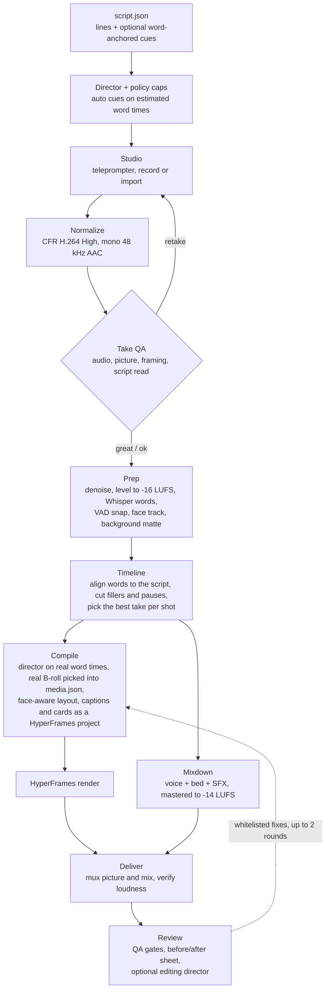

# Reel Director

**Plan a talking-head reel's edit from the script before you record. Then record, and the reel builds itself.**

Reel Director turns a list of lines into a full edit plan before the camera rolls: hook title, punch-ins, B-roll cards, transitions, sound effects and a music bed, every cue anchored to a word. You record in a local browser studio with a teleprompter. Each take is checked on the spot for audio, picture, framing and whether you read the script. One build then cleans the audio, cuts fillers, restarts and long pauses, picks the best take per shot and re-times every caption and cue to the words you actually spoke. It renders with [HyperFrames](https://github.com/heygen-com/hyperframes), masters the mix to -14 LUFS and runs quality gates on the finished file. The creator only records and speaks.

B-roll can be real media too: free and Creative Commons stock, your own clips, motion graphics that Claude writes for the line, or paid Veo and Higgsfield clips that you approve one by one. Every pick is licence-checked and credited.

> Status: early (v0.0.1). macOS on Apple Silicon only. 760 unit tests pass against motion-pack v0.3.0, plus an end-to-end suite that drives real Chrome with a fake camera and microphone.

**Contents:** [How it works](#how-it-works) · [Features](#features) · [Real B-roll](#real-b-roll-media-engine) · [Requirements](#requirements) · [Quickstart](#quickstart) · [CLI reference](#cli-reference) · [Writing a script](#writing-a-script) · [Project layout](#project-layout) · [Testing](#testing) · [Roadmap](#roadmap) · [Credits](#credits) · [Licence](#licence) · [Contributing](#contributing)

---

## How it works



- **The plan comes first.** Cues anchor to words, never to seconds (`"at": "three hours"`), so a bad anchor fails at load time, before anyone records. The director plans on a read-time estimate (about 165 words per minute). At compile time it plans again on the real word times.
- **Auto cues never touch your script.** They go to `directed.json`. Every auto cue carries a `why` that names the rule behind it. Manual cues always win.
- **Preview before you record.** The Studio's *Preview edit* renders the whole directed reel at draft quality. It uses your takes where they exist and RECORD slots everywhere else.
- **Deterministic.** The same script and takes give the same edit and the same samples. The director uses word lists and rules, with no model and no randomness. The render runtime is a pure function of time: no `Math.random`, no clock. Punch jitter is seeded from `crc32(title)`.

## Features

### Director and presets

- **A lines-only script becomes a full cue plan.** The director adds:
  - a hook title on frame 0, held to about 2.5 s;
  - a pattern-interrupt punch inside the first second;
  - B-roll cards on spoken numbers (stat) and enumerations (list), and on concrete nouns either real pictures and clips ([Real B-roll](#real-b-roll-media-engine)) or text cards, often with a Lucide icon badge;
  - transitions only at section boundaries;
  - caption emphasis on numbers, money and negations;
  - sound effects on the hook, transitions and card entrances;
  - a lower third when `style.creator` is set, and an opt-in end card.
- **Punch ladder.** Punches are instant reframes about the eye midpoint, on three levels: W 1.00, M 1.17 and T 1.32.
  - The reel opens at M on frame 0 and the first change lands at 0.5-1.0 s.
  - Consecutive punches always change level. The last punch lands on M, so the loop closes where it opened.
  - There is at most one T per reel (two over 45 s), and only on takes at least 1440 px wide in the 9:16 crop.
  - Every level is capped at 1.10 x crop width / 1080. A punch under 8 % (cap below 1.08) is switched off rather than shown as camera wobble.
- **Policy caps per pace,** enforced after the director (`policy.py`, `pace.py`):

  | Pace | Median visual change | Max static | B-roll cap | SFX per 30 s | Auto transitions (reel of T s) |
  |---|---|---|---|---|---|
  | calm | 4.0 s | 6 s | 15 % | 3 | none |
  | standard | 2.6 s | 4 s | 25 % | 6 | at most min(3, T/12) |
  | punchy | 1.8 s | 3 s | 35 % | 8 | at most min(3, T/10) |

  - **Rhythm.** A coefficient of variation under 0.25 between changes counts as metronomic, as does a median gap outside the pace's range (calm 2.4-6.0 s, standard 1.9-3.5 s, punchy 1.3-2.4 s). Either one triggers a deterministic re-plan of the auto punches. If that does not fix it, the pace gate fails.
  - **Cuts and inserts.** At least 90 % of cuts are hard cuts, and an auto transition lasts 9 frames. B-roll inserts last 1.2-3.0 s (auto label-only text cards at most 1.5 s) and lead their word by 4 frames.
  - **Face time.** There is at least 1.5 s of face between inserts, and the face is on screen for the last 2.5 s.
  - **Sound effects.** SFX sit at least 1.0 s apart, with none in the last 0.5 s.
- **Six presets.** Each one is a full `style`. Your script can override any key.

  | Preset | Font | Captions | Accent | Grade | Auto card background | Pace | Transition family | Music mood |
  |---|---|---|---|---|---|---|---|---|
  | `clean-pro` (default) | Inter 800 | pill | `#4F8CFF` | cool | mesh | standard | push | optimistic |
  | `bold-hustle` | Montserrat 900 | bold | `#FFE14D` | none | solid | punchy | whip | confident |
  | `beast-hype` | Bangers | pop | `#00E676` | warm | grid | punchy | zoomThrough | hype |
  | `editorial` | Instrument Serif | boxed | `#E4572E` | warm | paper | calm | none | calm |
  | `tech-explainer` | Inter 800 | boxed | `#00D1FF` | cool | grid | standard | push | tech |
  | `desi-bilingual` (beta) | Noto Sans Devanagari 800 | karaoke | `#FF9933` | warm | blur | standard | whip | warm |

  - **Tone.** Each preset also carries a subtle grade tuned to leave skin alone (skin ΔE2000 0.8-1.5 measured per tone, `presets.py`). It also sets background blur and dim values (`look.bgfx`), which the runtime applies when prep did not bake a matte.
  - **desi-bilingual** is beta. Roman-script Hinglish works. A line written in Devanagari fails with an error in `direct`, `compile` and Studio builds, instead of silently dropping words from the captions. `validate` does not check for it yet.
- **Switches.**
  - Turn the director off for the reel with `--no-auto` or `style.auto_off`.
  - Turn it off for single shots with `style.auto_skip_shots`.
  - Turn it off for one shot and one cue kind with `"auto": {"broll": false}` on that shot.
  - Turn real-media B-roll off with `"style": {"media": false}`; the director then makes cards only.

### Recording studio

- **Local and lightweight.** `python -m reel_director studio` is a stdlib HTTP server bound to 127.0.0.1, with plain HTML/JS and no build step.
  - Host and Origin checks refuse DNS rebinding and cross-site POSTs.
  - Media paths are traversal-safe and served with HTTP Range support.
- **Teleprompter** at the top centre of the screen, close to the webcam. The line is fitted to two or three lines at 44 px or larger, with that shot's cues shown under it.
  - A 3-2-1 countdown starts every take. The recorder starts on "1", a second before you speak.
  - Keys: <kbd>Space</kbd> records and stops, <kbd>R</kbd> starts the take over, <kbd>N</kbd>/<kbd>P</kbd> or the arrow keys change shot.
  - It can optionally move on after a great take.
- **Capture quality.**
  - Native camera formats only (`resizeMode: "none"`). The Studio keeps whichever of the portrait and landscape modes gives the larger 9:16 area.
  - Browser echo cancellation, noise suppression and auto gain are off.
  - The recorder prefers MP4 avc3, then avc1, then WebM, at clamp(W x H x fps x 0.30, 8-40 Mbps) for video and 256 kbps for audio.
  - It warns about virtual (Zoom, BlackHole, Teams, Loom) and Bluetooth microphones.
- **Live meters.** Mic peak with hold and a clip light at -0.3 dBFS, the room noise floor and brightness. 9:16 and platform safe-zone guides sit over the preview.
- **Framing coach.** It uses the MediaPipe face detector, loaded from a CDN and quietly absent offline. The creator profile from `learn creator` tunes it.
- **Takes.**
  - Record, or import an existing MP4, MOV or WebM. iPhone rotation is applied on import.
  - Pin or discard takes. Every upload is kept as received in `raw/orig/`. Discarding a take moves its files (normalized take, original and QA reports) into `raw/discarded/`; nothing is deleted.
  - The build uses only takes that QA did not send back for a retake, unless you pin one.
- **One-button build:** prep, compile, render, master and review. The result dialog shows:
  - the measured loudness;
  - the take used and the number of cuts for each shot;
  - the QA verdict and every gate;
  - the editing director's note;
  - the before/after sheet.
- **Build options.** A preset picker. Two toggles: background matte (on by default) and editing director (off by default).
- **B-roll panel.** Every real-media insert of the last plan with its pick, licence, alternates and credits. Swap, reject, change the treatment or approve a paid clip; the next build or preview uses it (see [Real B-roll](#real-b-roll-media-engine)).

### Take QA

`check-take` runs automatically after every take lands in the Studio. It transcribes with mlx-whisper, measures the take and returns `great`, `ok` or `retake` with actionable messages (for example "move about 5 cm to your left", using the 6.3 cm average pupil distance as the ruler). Thresholds from `takecheck.py`:

| Check | Retake (fail) | Warning |
|---|---|---|
| Script read | any misread word, shown in context ("you said ... / script: ..."); under 85 % of the line heard | a skipped word |
| Clipping | more than 10 samples at or above -0.3 dBFS | |
| Silence | under -40 LUFS (wrong or muted mic) | |
| Noise | SNR under 15 dB | SNR under 25 dB |
| Microphone | | virtual device or Bluetooth mic |
| File | decode errors in the converted take | |
| Exposure | | subject brightness under 60 or over 200 (of 255), or over 25 % blown out |
| Resolution | | the 9:16 crop is narrower than the reel |
| Focus | | blur score over 8, or no fine detail at all |
| Camera | | under 24 fps, or more than 3 dropped frames |
| Framing | | face in frame for under 80 % of the take; eye line not reachable at 0.40 H ± 0.03; face under 12 % or over 30 % of the height; more than 8 % off-centre |
| Length | | take longer than 3x the estimated read |

### Cleanup and audio

- **Normalize every Studio take.** Every take recorded or imported in the Studio becomes constant-frame-rate H.264 High (CRF 14) with mono 48 kHz AAC at 256 kbps.
  - Frame rate is rounded to 24, 25, 30 or 60.
  - HDR is converted to SDR BT.709, and full-range or BT.601 sources to limited-range BT.709.
  - The CLI `prep` does not normalize: it stream-copies the picture and re-encodes only the audio.
- **Prep each take.**
  - An 80 Hz high-pass on every take. `afftdn` denoise only below 35 dB SNR, with its 25 ms delay compensated so audio stays sample-aligned with the picture.
  - Leveling to -16 LUFS uses a measured linear gain and a limiter, never ffmpeg's dynamic loudnorm.
  - Words come from mlx-whisper (Whisper large-v3-turbo) word timestamps, snapped to Silero VAD speech regions.
- **Alignment and cutting.**
  - Script words are aligned to what was heard. Fillers (um, uh, ...) and restarts are skipped, and on a restart the last read wins.
  - Numbers match their spoken form ("3" = "three"). Homophones (reel/real) and spelling variants (colour/color) are never flagged as misreads.
  - Pauses over 0.45 s and junk words between script words are cut, with 80 ms and 120 ms pads.
  - Where two shots meet, the seam is tightened to the voice: 40 ms before the voiced onset, 60 ms after the voiced offset.
- **Take picking.** Every candidate is scored as `100 x coverage - 8 x misreads - 0.5 x junk words - 1 x cuts - 0.5 x kept seconds`. A pinned take wins, and on a tie the later take wins.
- **Mixdown** (`mixdown.py`) bakes everything you hear into one `mix.wav`, at 48 kHz, 24-bit stereo.
  - **Voice.** Sample-exact slices with 10 ms raised-cosine fades at every cut. Junk tails at a cut are gated to the room floor, and each shot is leveled on what ships.
  - **Bed.** A motion-pack bed picked by mood and length, rolled so a bar downbeat lands on the hook. It sits 5 LU under the voice and ducks 10 dB under speech (80 ms look-ahead, 15 ms attack, 120 ms hold, 350 ms release), holding through pauses under 0.6 s. It gets a -5 dB low shelf at 150 Hz plus a mid carve, ends on a bar, and uses loop beds only up to 32 s.
  - **SFX.** motion-pack sounds land with their anchor on the frame after the word starts. Every effect is gain-staged from its measured loudness relative to the voice and never peaks above the voice.
  - **Master.** -14 LUFS integrated through a 4x true-peak look-ahead limiter. AAC encode/decode round trips then lower the ceiling until the encoded true peak is at or below -1.6 dBTP.
  - **Extra files.** The mix also writes stems (voice, music, dry music, SFX) and a `mix.nomusic.wav` for adding a trending sound in the app.
- **Deliver.** `deliver` stream-copies the rendered picture, muxes in the mix and measures the encoded file. It must land at -14 ± 0.5 LUFS and at or below -1.5 dBTP true peak. If not, it re-levels up to 3 more times and exits with code 3 if it still misses.

### Picture and captions

- **HyperFrames project.** The compiler writes a standalone HyperFrames project around `index.html`. Fonts, motion-pack modules, takes and the mix are hard-linked into it (symlink, then copy, as fallbacks), and the runtime (`reel.mjs`, `reel.css`) is copied. Takes are muted video layers, and all sound comes from the baked mix.
- **Faces are sacred.** No caption, title or sticker box may overlap the padded face (eyes, nose and mouth, padded by 6 % of the face height) on any frame. Full-screen cards hide the face by design.
  - Apple Vision tracks the face on every 3rd frame, smoothed.
  - Each take is auto-reframed toward an eye line at 0.40 H ± 0.03, within a 1.10 scale cap and with at least 4 % headroom. Every shot shares one reframe scale, so the framing does not jump in scale at a cut.
  - The caption zone is chosen per shot: below the chin, else above the head, else the lower band.
- **Captions.**
  - Six families: `bold`, `pop`, `karaoke`, `pill`, `boxed`, `minimal`.
  - Each family has a target chunk size (`pop` 2 words; `bold`, `pill` and `boxed` 3; `karaoke` and `minimal` 4) and a hard cap of 4 words (3 for `pop`). A chunk takes at most 2 lines and is never smaller than 64 px. A chunk never ends on an article, preposition, conjunction or possessive, and never splits a number from its unit.
  - At most 12 % of words are highlighted.
  - Text entrances are at least 6 frames apart.
  - All text stays inside the safe rect: x 120-888, y 288-1248 on a 1080x1920 frame.
  - One text block at a time: no captions under the hook title or a full card.
- **B-roll cards.** Kinds: `text`, `stat`, `list`, `icon`, `clip` and `media` (real B-roll, below). Layouts: `full`, `split` and `pip`, plus `inset` for `media`.
  - Cards have animated backgrounds (mesh, grid, paper, blur, solid) and kinetic type.
  - A stat counts up over 18 frames with a ring. List items tick on their spoken word.
  - Icon badges come from 67 vendored Lucide glyphs, inlined as CSS masks.
  - When a face track exists, an auto list or stat card that would break the face-time rules goes split instead, with the face kept in the lower pane.
- **Looks.** Presets keep grain at or below 0.08 and vignette at or below 0.18. The Studio's background matte (Apple Vision person segmentation) blurs and dims the wall behind you. It is a deeper blur on the far wall above the head, baked into `<take>.bg.mp4` in one ffmpeg pass.
- **Fonts.** 8 OFL font families are bundled (see [Credits](#credits)).

### Real B-roll (media engine)

The director can show real pictures and clips, not only motion-graphic cards. On a concrete noun that has a picture ("laptop", "money", "clock", "city": 30 word groups in `broll_media.py`) it plans a `broll` cue of kind `media`: a search query, still or clip, a source order, a treatment and a layout. It also upgrades its own text and icon cards on such nouns. `compile`, and every Studio build or preview, then resolves these cues into `media.json` **before anything renders**. Each cue is searched across the sources below, licence-checked, ranked, downloaded into a local cache and cut to fit. A cue that finds nothing usable shows the text card it replaced, so a missing picture never breaks a build. A decision in `media.json` is never re-picked, so the same `media.json` renders the same reel.

- **How much.** Six edit recipes set the density. Each preset maps to one (`style.recipe` picks another), and they aim for 25-35 % of the runtime on real media. A new insert never pushes all B-roll past 40 % of the reel.
  - Inserts last 1.2-3.0 s. Added inserts start after the hook title (2.5 s).
  - Never over a spoken number (the stat card owns it), a list or the payoff.
  - The usual face rules hold: 1.5 s of face between face-off inserts and the face on screen for the last 2.5 s.
- **Sources.** `media status` shows which ones are live and what each still needs.

  | Source | Gives | Needs |
  |---|---|---|
  | `library` | your own images and clips, searched first | a folder in `REEL_DIRECTOR_MEDIA_LIBRARY`. Folder names and `<file>.json` / `<file>.txt` sidecars act as tags. |
  | `openverse` | CC and public-domain images | nothing |
  | `wikimedia` | Wikimedia Commons images and video | nothing |
  | `nasa` | NASA Image and Video Library (public domain) | nothing |
  | `archive` | Internet Archive films | nothing |
  | `webcapture` | screenshots of a page, when the query is a URL | the HyperFrames CLI (`hyperframes capture`) |
  | `pixabay` | photos and video | a free key: `PIXABAY_API_KEY` |
  | `unsplash` | photos | a free key: `UNSPLASH_ACCESS_KEY` |
  | `coverr` | stock video | a free key: `COVERR_API_KEY` |
  | `youtube_cc` | Creative Commons YouTube videos | `YOUTUBE_API_KEY`, or gcloud application-default credentials with the YouTube read-only scope |
  | `claude_clip` | motion-graphics clips that Claude writes for the line | the `claude` CLI, logged in |
  | `veo` | Google Veo 3.1 clips on Vertex AI (**paid**) | `gcloud`, logged in, and a Google Cloud project |
  | `higgsfield` | Seedance 2.0 and Kling 3.0 clips (**paid**) | a Higgsfield API key in `HF_KEY` |

  Keys are read from the environment of the shell that runs `compile` or `studio`. Without its key a source is simply off.
- **Picking.** Candidates are scored 0.5 relevance + 0.3 quality + 0.2 licence, deterministically.
  - Relevance: the query's words in the title, tags and description.
  - Quality: resolution after a cover-fit into the frame and how much of the picture survives the crop, lowered for watermark or text hints and for Commons personality or trademark restrictions.
  - The best free pick that downloads wins (a dead link falls through to the next). Up to four alternates are kept for swapping.
  - **Clips.** A clip plays a window inside one shot (ffmpeg scene cuts), away from cuts and, with Apple Vision, from other people's faces and on-screen text. When the clip has a clear visual payoff (a counter landing, a check popping), its timing puts the payoff on the line's result word. A source longer than 60 s is fetched as a 15 s window rather than the whole film (YouTube downloads the stream, then trims it locally).
- **Licences: commercial-safe only.**
  - Allowed: CC0, the Public Domain Mark, public domain and CC BY. Also the Pixabay, Unsplash and Coverr licences, your own media, clips made for the reel, and screenshots of a page you supply (you confirm you may show it).
  - CC BY-SA is off unless you opt in with `RD_MEDIA_SHARE_ALIKE=1`, because the adapted insert inherits share-alike.
  - Rejected: NC and ND (a reel is commercial, and cropping, grading and trimming are adaptations), GFDL alone, "all rights reserved" and anything unrecognised.
  - Internet Archive search stays inside the Prelinger, FedFlix and NASA collections, whose uploaders hold the rights. `REEL_DIRECTOR_ARCHIVE_ANY_UPLOADER=1` opens every upload, ranked lower and flagged. NASA items that name another rights holder are dropped.
- **Credits.** Every pick carries a credit line: title, author, source and licence, plus "modified" for CC BY and BY-SA.
  - A build writes `renders/reel.credits.txt` beside the reel, listing only the media the reel shows, with a share-alike notice when one applies. Paste it under the post.
  - Claude, Veo and Higgsfield inserts get an "AI-generated insert" line instead, so you know what to label when you post.
  - `media credits BUILD` prints the same list.
- **YouTube Creative Commons.** Search uses the YouTube Data API v3 with `videoLicense=creativeCommon`. YouTube's only CC licence is CC BY 3.0. Each `search.list` call costs 100 of the default 10,000 daily quota units.
  - Without a credential, `media status` prints the exact gcloud commands to create a key restricted to the YouTube Data API.
  - **Downloading is off by default**. While it is off, a YouTube result can never be fetched, so it never becomes a pick. YouTube's Terms of Service forbid downloading except through YouTube's own features, even for Creative Commons videos.
  - `REEL_DIRECTOR_YOUTUBE_DOWNLOAD=1` opts in at your own risk. yt-dlp then fetches CC BY videos only, re-checked from yt-dlp's metadata before any media byte. The warning is printed in the CLI and shown in the Studio, the clip is credited, and every attempt is logged to `<cache>/logs/youtube_downloads.jsonl`.
- **Claude-authored clips.** `claude_clip` asks your local `claude` CLI (`claude -p`) to write a 3-4 s HyperFrames motion-graphics composition for the brief. It works in a sandbox (`work/media-claude/`) holding motion-pack modules and the bundled fonts and icons.
  - It runs on your subscription login: `ANTHROPIC_API_KEY` is removed from its environment, so it never bills an API key. `GEMINI_API_KEY` is removed too, so no frame goes to Gemini.
  - Every attempt is checked: no clocks, randomness or network, `hyperframes lint`, a render, a frame check, and a seek check that out-of-order frames match the render. A failed attempt is retried up to twice with the errors fed back.
  - Accepted clips are cached by brief and reused for later briefs that share their words.
- **Paid generators: Veo and Higgsfield.** Neither is in a default search order, and neither spends on its own.
  - **One paid-eligible insert per reel** by default: the first full-layout clip. Only that cue lists the paid sources.
  - **Searching only quotes.** Veo prices from the per-second rates in `media/providers/veo.py`, with no network. Higgsfield prices from its free estimate endpoint. The quote goes into a local ledger.
  - **Per-clip approval.** Approve each clip in the Studio's B-roll panel, which shows the cost, or with `python -m reel_director.media.budget approve <request_id>`. Approval checks a per-reel cap ($5), a daily cap across all reels ($20) and the paid-clip limit (1 per reel). An approval expires after 24 hours and buys exactly one submission.
  - **Generation.** The next build generates the approved clip once. It records the provider's job id, so an interrupted run resumes polling instead of paying twice, then settles the ledger.
  - **Ledger.** An append-only JSONL file on the local disk: `$REEL_DIRECTOR_CACHE/media/paid-ledger.jsonl` (default `~/.cache/reel-director/media/paid-ledger.jsonl`). An unreadable line fails closed. Change the caps with `REEL_DIRECTOR_PAID_PER_REEL_USD`, `REEL_DIRECTOR_PAID_DAILY_USD` and `REEL_DIRECTOR_PAID_MAX_CLIPS`.
  - Veo runs in `us-central1` and defaults to `veo-3.1-fast-generate-001`. `python -m reel_director.media.providers.veo probe` checks the models and your permissions for free.
- **Treatments and layouts.** The runtime (`web/broll.mjs`) is a pure function of time, like the rest of the reel.

  | Treatment | What it does |
  |---|---|
  | `fullbleed` | the picture fills the frame, settles over 8 frames, then pushes in slowly |
  | `kenburns` | an eased zoom or pan over the insert, seeded per insert |
  | `parallax` | 2.5D for stills: the cut-out subject zooms faster than its background |
  | `sticker` | stills: the cut-out subject with a white outline pops in and floats |
  | `device` | the media inside a phone, laptop or browser mockup that rises and settles |
  | `polaroid` | stills: the photo drops onto a fanned stack and develops |
  | `reveal` | a circle opening from the face, a wipe, or the media seen through a word |
  | `inset` | a rounded picture-in-picture beside the face |

  - Layouts: `full` hides the face by design, `split` puts the media on top and the face below, `pip` puts a face circle over the media, and `inset` keeps the face. An inset box stays clear of the padded face, the captions and the title, or the insert falls back to split.
  - Captions always paint above B-roll. The media takes the reel's grade plus a gentle brightness and saturation match to your take.
  - Cut-outs use Apple Vision's foreground instance mask (macOS 14 or newer), else `hyperframes remove-background`. Without a cut-out, parallax uses a soft focus layer and the sticker becomes a photo card.
- **`media.json` and the Studio B-roll panel.** `media.json` sits next to `directed.json`. A Studio project keeps one at its root, shared by builds and previews.
  - Per insert it holds the query, the pick (local file, licence, credit, clip window), the alternates, notes and a status: `picked`, `swapped`, `rejected`, `unresolved`, `awaiting_approval` or `approved`.
  - The Studio's **B-roll** panel shows every insert with its thumbnail, a licence badge (share-alike flagged, AI-generated labelled) and its alternates. You can swap to a free alternate, reject a pick (its text card shows instead) or restore it, change the treatment, and approve the reel's paid generation with its cost and the caps in view.
  - Decisions apply on the next build or preview. The [`media` commands](#cli-reference) do the same from the terminal, plus `media use` to search with your own words.
- **Offline.** `RD_MEDIA_OFFLINE=1` skips every search and download. Picks already in the cache still render; inserts with nothing downloaded keep their text card.

### Quality gates

`review` runs deterministic gates. Most of them read the **rendered master**: faces are detected on output frames and intersected with the layout boxes, and contrast, loudness, A/V sync and black or frozen video are measured on the encoded file. `pace` and `safe_zone` read the compiled plan and `reel/layout.json`. The results are written to `qa/report.json`, `qa/overlay.png` and `renders/before-after.png`.

| Gate | Target |
|---|---|
| `text_over_face` | 0 frames with any text box over the padded face |
| `caption_contrast` | at least 4.5:1 effective contrast |
| `title_legibility` | at least 4.5:1 over its plate; a busy background needs a solid or blurred backdrop |
| `head_clearance` | text at least 16 px above the head top (person matte) |
| `safe_zone` | all captions and the title inside x 120-888, y 288-1248 |
| `pace` | median gap inside the pace's range, CV at least 0.25 (target 0.35-0.75), max static within the pace limit, first change by 1.0 s |
| `loudness` | -14 ± 0.5 LUFS, true peak at or below -1.5 dBTP, short-term max at or below -9 LUFS |
| `av_sync` | start offset and duration difference within 1 frame |
| `black_frozen` | no black or frozen video outside designed cards |
| `broll_face` | face-off B-roll within the pace cap, face on at least 90 % of face shots, never more than 6 s without the face (B-roll on screen counts every layout) |
| `framing` | eye line at 0.40 H ± 0.03 (a warning when only moving the camera can fix it) |
| `media_share` | real-media inserts 25-40 % of the runtime (a warning outside that; a reel without real media passes) |
| `media_text` | 0 caption or title boxes touching a media object (device, polaroid, sticker, inset) while both are on screen |

- **Score and verdict.** The gate score is 100 minus 20 per fail and 5 per warning. When the editing director answers, the overall score is the mean of the gate score and the director's score. A failing gate with no automatic fix gives `block`. Any other failure, or a high-severity director issue, gives `fix`. Otherwise the verdict is `ship`.
- **Editing director (opt-in).** `review --director` runs your local `claude` CLI headless, with the Read tool only. It reads the before/after sheet, the QA overlay and the JSON reports, and scores the reel against a fixed rubric. It answers in a JSON schema.
  - Only whitelisted fixes are applied (`move_caption`, `drop_cue`, `change_preset_param`, `reframe`), to a copy of `directed.json`. `retake` goes to a human.
  - With `--rounds 1|2` the reel is rebuilt, re-rendered and re-reviewed. A round is kept only if its score improves.
  - With no CLI, a logged-out CLI or a timeout, the review is skipped with a note.

## Requirements

| Need | Why |
|---|---|
| macOS on Apple Silicon | Apple's MLX framework runs mlx-whisper. Apple Vision (through pyobjc) does the face track and the person matte. |
| Python 3.11 or 3.12 | `requires-python = ">=3.11,<3.13"` |
| `ffmpeg` and `ffprobe` 8 or newer, on `PATH` | Intake, cleanup, loudness (`ebur128`), denoise (`afftdn`), focus (`blurdetect`), QA. HDR imports use ffmpeg 8's colour-managed `scale` options. Developed against 8.0.1. |
| Node.js 22 or newer + the HyperFrames CLI | Rendering: `npm install -g hyperframes@0.8.177`, the tested version. |
| A checkout of [motion-pack](https://github.com/ANVEAI/motion-pack) v0.3.0, with its sound library built | Transitions, grade layers, SFX and music beds. motion-pack's WAV libraries are generated, not committed, so a bare clone is not enough (see [Install](#1-install)). |
| Google Chrome | The Studio is built and tested for Chrome. The e2e suite drives the installed Chrome. |
| Optional: the `claude` CLI, logged in | The editing director (`review --director`) and Claude-authored B-roll clips. |
| Optional: the Google Cloud CLI (`gcloud`), logged in | Paid Veo clips, and the application-default credential option for YouTube CC search. |
| Optional: `yt-dlp` | Only for opt-in YouTube CC downloads (`REEL_DIRECTOR_YOUTUBE_DOWNLOAD=1`). |
| Optional: macOS `say` | Generates the demo takes and the e2e fake media. |
| Optional: `swiftc` (Xcode Command Line Tools) | Without pyobjc, QA's face check compiles a small Apple Vision helper with it. Without either, QA warns that faces were not checked. |

Python dependencies (`pyproject.toml`): `mlx-whisper`, `silero-vad`, `soundfile`, `numpy<2`. The `mac` extra adds `pyobjc-framework-Vision` and `pyobjc-framework-Quartz`. The `dev` extra adds `pytest` and `playwright`. PyTorch arrives through both mlx-whisper and silero-vad. SciPy, which `mixdown.py` and `levels.py` import directly, arrives through mlx-whisper. Licences for all of these are in [THIRD_PARTY.md](THIRD_PARTY.md).

**Network use:**
- The first transcription downloads `mlx-community/whisper-large-v3-turbo` from Hugging Face.
- Compiled reels load GSAP 3.14.2 from jsDelivr when they render or preview.
- The Studio's framing coach loads MediaPipe Tasks Vision 0.10.21 from jsDelivr and its face model from storage.googleapis.com. Offline, the coach stays off.
- The HyperFrames CLI sends anonymous usage telemetry. Opt out with `HYPERFRAMES_NO_TELEMETRY=1` or `DO_NOT_TRACK=1`. Its first render may download a headless Chrome into `~/.cache/hyperframes/chrome`.
- `compile`, Studio builds and previews resolve the director's real-media B-roll: they search the media sources that are on (Openverse, Wikimedia Commons, NASA and the Internet Archive need no key) and download the picks into the media cache. `RD_MEDIA_OFFLINE=1` keeps a build offline. Only search queries go out, plus the download pings that Unsplash and Coverr require.
- Claude-authored clips load GSAP 3.14.2 and three.js 0.160.0 from jsDelivr when they render.
- Takes and renders never leave the machine, except the images and reports the opt-in editing director reads through your own `claude` login. A Claude clip's brief and the line's words go to your `claude` login. A paid clip's prompt goes to Google or Higgsfield only after you approve its quote.

**Environment variables:**

| Variable | Used by | Default |
|---|---|---|
| `RD_PACK` | staging pack modules into a reel, schema id checks | `~/Developer/motion-pack-public` |
| `MOTION_PACK` | mixdown (beds, SFX), schema id checks | `~/Developer/motion-pack-public` |
| `REEL_DIRECTOR_PACK` | schema id checks only (a third fallback after `RD_PACK` and `MOTION_PACK`) | `~/Developer/motion-pack-public` |
| `REEL_DIRECTOR_CACHE` | the compiled Apple Vision helper QA falls back on without pyobjc; the paid-generation ledger (`media/paid-ledger.jsonl`) | `~/.cache/reel-director` |
| `RD_MEDIA_OFFLINE` | `1`: builds skip B-roll search and downloads | off |
| `REEL_DIRECTOR_MEDIA_CACHE` (or `RD_MEDIA_CACHE`) | the content-addressed B-roll cache | `~/.cache/reel-director/media`, 5 GB LRU cap (see below) |
| `REEL_DIRECTOR_MEDIA_LIBRARY` | your own media folder, searched first | none: the `library` source is off |
| `PIXABAY_API_KEY`, `UNSPLASH_ACCESS_KEY`, `COVERR_API_KEY` | free stock keys (`REEL_DIRECTOR_PIXABAY_KEY`, `REEL_DIRECTOR_UNSPLASH_KEY` and `REEL_DIRECTOR_COVERR_KEY` work too) | unset: the source is off |
| `YOUTUBE_API_KEY` (or `REEL_DIRECTOR_YOUTUBE_API_KEY`) | YouTube CC search | unset |
| `REEL_DIRECTOR_YOUTUBE_AUTH=adc`, `REEL_DIRECTOR_YOUTUBE_QUOTA_PROJECT` | YouTube CC search with gcloud application-default credentials instead of a key | unset |
| `REEL_DIRECTOR_YOUTUBE_DOWNLOAD` | `1`: download CC BY YouTube clips with yt-dlp (against YouTube's Terms of Service) | off |
| `RD_MEDIA_SHARE_ALIKE` | `1`: allow CC BY-SA picks | off |
| `REEL_DIRECTOR_ARCHIVE_ANY_UPLOADER` | `1`: search every Internet Archive upload, not only the curated collections | off |
| `REEL_DIRECTOR_VEO_PROJECT`, `REEL_DIRECTOR_VEO_LOCATION`, `REEL_DIRECTOR_VEO_MODEL` | Veo on Vertex AI | gcloud's configured project, `us-central1`, `veo-3.1-fast-generate-001` |
| `HF_KEY` (`<key_id>:<key_secret>`; or `HF_CREDENTIALS`, or `HF_API_KEY_ID` + `HF_API_KEY_SECRET`) | Higgsfield | unset: the source is off |
| `REEL_DIRECTOR_PAID_PER_REEL_USD`, `REEL_DIRECTOR_PAID_DAILY_USD`, `REEL_DIRECTOR_PAID_MAX_CLIPS` | paid-generation caps | `5`, `20`, `1` |
| `REEL_DIRECTOR_PAID_LEDGER` | the paid-generation ledger file | `$REEL_DIRECTOR_CACHE/media/paid-ledger.jsonl` |
| `RD_CLIP_MODEL`, `RD_CLIP_WORK` | Claude clips: the model `claude -p` uses, and the sandbox folder | the CLI's default model, `work/media-claude` in the repository |
| `CLAUDE_CODE_OAUTH_TOKEN` | Claude clips: a long-lived token from `claude setup-token`, instead of `claude auth login` | unset |

When the external drive named in `media/cache.py` (`DRIVE`) is mounted and writable, the media cache lives on it instead (50 GB cap), and a `reel-director/library` folder on it becomes the default library. Builds read API keys from the environment only (`media status` and `media search` also take `--settings FILE`); never commit them.

Clone motion-pack to the default path and no variable is needed. Anywhere else, set `RD_PACK` and `MOTION_PACK` to the same checkout in every shell that runs Reel Director, including the one that starts `studio` (or add the `export` line to your shell profile).

## Quickstart

### 1. Install

```bash
# motion-pack v0.3.0 (the tested version) at the default path Reel Director looks in
git clone --branch v0.3.0 https://github.com/ANVEAI/motion-pack.git ~/Developer/motion-pack-public
(cd ~/Developer/motion-pack-public \
  && python3.11 -m venv .venv && .venv/bin/pip install -r requirements.txt \
  && .venv/bin/python sfx/build_library.py \
  && .venv/bin/python music/build_music.py)    # builds the sound library: sfx/library/ and music/library/

git clone https://github.com/ANVEAI/reel-director.git
cd reel-director
python3.11 -m venv .venv
.venv/bin/pip install -e '.[mac,dev]'
npm install -g hyperframes@0.8.177        # Node 22+; the tested version
```

- **Build motion-pack's sound library.** Its WAV files are generated, not committed. Without them, `compile` stops on the first music bed or pack sound effect. Instead of building, you can unzip `motion-pack-sfx-wav-v0.3.0.zip` and `motion-pack-music-wav-v0.3.0.zip` from motion-pack's v0.3.0 release at the motion-pack root. Release zips match their own tag only.
- **Stay on v0.3.0.** Reel Director is tested against that tag. motion-pack's `main` has moved on and is untested here.
- **motion-pack somewhere else?** Run `export RD_PACK=/path/to/motion-pack MOTION_PACK=/path/to/motion-pack` in every new shell before `compile` or `studio`, or add it to your shell profile.

### 2. Build the demo reel from the command line

The demo script is `examples/demo/script.json`: three shots with a few manual cues. `make_demo_media.py` synthesizes its sound effects and music bed. It also makes four flawed takes read by macOS `say` over coloured gradients: a misread ("three days"), a pause and an "uh", an "um" with a restart, and a pause mid-line.

```bash
.venv/bin/python scripts/make_demo_media.py      # examples/demo/media/ + work/demo/takes/

.venv/bin/python -m reel_director validate examples/demo/script.json
.venv/bin/python -m reel_director prep work/demo/takes/takes.json --out work/demo/prepped
.venv/bin/python -m reel_director compile examples/demo/script.json --out work/demo/reel \
    --takes work/demo/prepped/takes.json
hyperframes render work/demo/reel -o work/demo/renders/reel.mp4 --quality delivery
.venv/bin/python -m reel_director deliver work/demo/renders/reel.mp4 work/demo/mix/mix.wav \
    work/demo/renders/reel-master.mp4
.venv/bin/python -m reel_director review work/demo
```

What each step shows:
- **compile** prints every candidate take's score. The hook's first take loses because it misreads "three hours". Compile also prints the director's pace metrics and every policy decision, and writes:
  - `work/demo/directed.json`
  - `work/demo/mix/mix.wav`, with its report and stems
  - the HyperFrames project in `work/demo/reel/`
- **deliver** prints the measured loudness, true peak and A/V offset of `work/demo/renders/reel-master.mp4`.
- **review** writes `work/demo/qa/report.json`, `qa/overlay.png` and `renders/before-after.png`.

The demo takes are gradients with a synthetic voice and no face. So `text_over_face` warns (no face to check), `broll_face` fails (face on 0 % of face shots) and `pace` fails (median gap 1.81 s, outside the standard pace's 1.9-3.5 s), and the verdict is `block`. Judge the demo on typography, motion, cuts and sound. Real footage exercises the face-aware layout.

To see what the director would do with a lines-only script, before any recording:

```bash
.venv/bin/python -m reel_director direct examples/demo/script-lines-only.json \
    --out work/demo/directed-preview.json --preset bold-hustle
```

### 3. Record your own reel in the Studio

```bash
.venv/bin/python -m reel_director studio examples/demo/script-lines-only.json --project work/my-reel
```

This opens `http://127.0.0.1:8765/`, in Chrome when it is installed.

1. Pick the camera and the microphone. A native portrait mode (1080x1920) keeps punch-ins on, capped at 1.10. An iPhone 4K portrait take (1440 px of 9:16 width after intake) gives the full W/M/T ladder. A 1080p landscape webcam leaves a 607 px crop and turns punch-ins off. Use a real microphone, not a virtual device or AirPods.
2. Read each line from the teleprompter: <kbd>Space</kbd> to record, <kbd>Space</kbd> to stop. Each take gets a QA verdict in the shot list. Retake anything marked "retake".
3. Optional: click **Preview edit** at any time to see the whole edit, with RECORD slots for shots you have not recorded yet.
4. Pick a style and click **Build reel**. The finished file is `work/my-reel/renders/reel-master.mp4`, shown with its QA report and before/after sheet.

To write your own script, copy `examples/demo/script-lines-only.json` and change the lines. See [Writing a script](#writing-a-script).

### 4. Optional: more B-roll sources

Openverse, Wikimedia Commons, NASA and the Internet Archive work without a key. Check what else can be switched on:

```bash
.venv/bin/python -m reel_director media status                       # every source, and what each still needs
export PIXABAY_API_KEY=... UNSPLASH_ACCESS_KEY=... COVERR_API_KEY=...   # free keys; set them in the shell that runs studio
.venv/bin/python -m reel_director media search "clock ticking" --kind video   # ranked candidates, nothing downloaded
.venv/bin/python -m reel_director media credits work/my-reel           # credit lines for the media the last build shows
```

Paid Veo and Higgsfield clips stay off until their credentials are set, and even then each clip waits for your approval. See [Real B-roll](#real-b-roll-media-engine).

## CLI reference

All commands run as `python -m reel_director <command>`. Script and project errors exit with code 2.

| Command | What it does |
|---|---|
| `validate SCRIPT` | Parse the script and resolve every anchor. Prints words, estimated read time and cue count per shot. |
| `direct SCRIPT --out F [--takes T] [--preset P] [--no-auto]` | Run the director and policy caps and write the directed script. Prints pace metrics and every note. Uses real word times with `--takes`. |
| `prep TAKES --out DIR [--no-denoise] [--matte]` | Clean and level each take, transcribe it, snap words to speech and write face tracks. `--matte` also writes background-treated takes. Writes `DIR/takes.json`. |
| `compile SCRIPT --out DIR [--takes T] [--preset P] [--no-auto] [--no-mix]` | Direct, pick takes, cut, bake the mix (`DIR/../mix/mix.wav`), write `DIR/../directed.json` and the HyperFrames project in `DIR`. |
| `deliver RENDER MIX DST` | Mux the rendered picture with the baked mix and verify -14 ± 0.5 LUFS and at most -1.5 dBTP. Exits with code 3 on a miss. |
| `review BUILD [--director \| --director-json F] [--rounds 0-2] [--takes T] [--timeout S]` | QA gates and the before/after sheet on a built reel. Optionally adds the editing director and its fix rounds. |
| `learn creator PROJECT [--out F]` | Creator profile and coaching tips from a Studio project's takes: framing, light, voice, speech rate. Written to `qa/creator.json` by default. |
| `learn reference VIDEO... --out F [--no-asr]` | Style reference measured from local videos you supply: cut rate, caption region, B-roll share, speech rate. Never downloads anything. |
| `master SRC DST` | Loudness pass on a reel that carries its own audio, the fallback for `compile --no-mix`. |
| `transcribe MEDIA --out F [--model M]` | Word timestamps with mlx-whisper (default `mlx-community/whisper-large-v3-turbo`). |
| `check-take MEDIA --script S --shot ID --out F [--source F] [--capture-info F] [--model M]` | Take QA for one recording. |
| `studio SCRIPT --project DIR [--port 8765] [--no-open]` | The recording studio. |

B-roll media (`media_cli.py`). `BUILD` is a build folder, the one holding `directed.json` and `media.json`. The commands that read or change picks also take a `media.json` path, and `pick` takes a `directed.json`. Decisions take effect on the next compile; nothing is re-picked.

| Command | What it does |
|---|---|
| `media status [--settings F]` | Every B-roll source: ready or off, image or video, paid, and what it still needs. |
| `media search "QUERY" [--kind image\|video] [--providers a,b] [--orientation portrait\|landscape\|square\|any] [--limit N] [--context "WORDS"] [--paid] [--json]` | Ranked candidates, best first, with licence, size and source page. Downloads nothing. `--paid` lets preferred paid sources quote, which never spends. |
| `media pick BUILD [--media F] [--offline]` | The step `compile` runs: resolve the directed reel's media inserts into `media.json` (picks, alternates, credits). |
| `media fetch BUILD SLOT [--alt ID]` | Download a slot's pick, or a free alternate, into the media cache. Never a paid one. |
| `media swap BUILD SLOT ID` | Use a free alternate (downloaded now). |
| `media use BUILD SLOT "QUERY" [--kind image\|video] [--pick N]` | Search with your own words and use the N-th free result (see `media search`). |
| `media reject\|restore BUILD SLOT` | Show the text card instead, or take the pick back. |
| `media treatment BUILD SLOT NAME` | Change the slot's treatment (`kenburns`, `parallax`, `sticker`, `device`, `polaroid`, `reveal`, `fullbleed`, `inset`). |
| `media credits BUILD [--out F]` | Credit lines of the built reel (also refreshes `renders/reel.credits.txt`), else of `media.json`'s picks. |

Module tools for debugging single stages:

| Command | What it does |
|---|---|
| `python -m reel_director.qa BUILD [--out DIR] [--master MP4]` | QA gates, plus the before/after sheet (`renders/before-after.png/.json`). Exits with code 0 only on `ship`. |
| `python -m reel_director.review BUILD [--out DIR] [--director] [--director-json F] [--model M] [--apply]` | One review. `--apply` writes `directed.fixed.json`. |
| `python -m reel_director.before_after BUILD [--out DIR] [--master MP4] [--pairs N]` | Before/after sheet only. |
| `python -m reel_director.face MEDIA... --qa DIR` | Face tracks (`<take>.face.json`). |
| `python -m reel_director.matte MEDIA --out F [--kind alpha\|mask\|treated] [--quality fast\|balanced\|accurate]` | Person matte or background-treated take. |
| `python -m reel_director.icons` | Re-sync the inlined icon CSS in `web/reel.css` from `icons/lucide/`. |
| `python -m reel_director.media.budget [--ledger F] summary [--reel R] \| show ID \| approve ID \| reject ID` | The paid-generation ledger: spend against the caps, one quote, or approve or decline a quote. |
| `python -m reel_director.media.providers.veo probe \| estimate \| quote PROMPT --reel R --clip C \| generate ID` | Veo: free model and permission check, offline price, a quote in the ledger, and one approved generation (**paid**). |
| `python -m reel_director.media.providers.higgsfield estimate [PROMPT]` | Higgsfield: a free price check that proves the key. |

## Writing a script

A script is JSON. Only `shots[].line` is required. Write the lines, pick a preset and let the director plan the rest:

```json
{
  "title": "Reel Director demo",
  "style": {"preset": "bold-hustle"},
  "shots": [
    {"id": "hook", "line": "Most creators waste three hours editing one reel."},
    {"id": "turn", "line": "What if the edit was finished before you even pressed record?"},
    {"id": "cta",  "line": "Read the script, hit record, and the reel builds itself."}
  ]
}
```

Add manual cues where you want control. They are kept as written, and auto cues fit around them:

```json
{
  "title": "Three hours",
  "width": 1080, "height": 1920, "fps": 30,
  "style": {"preset": "clean-pro", "accent": "#FFD400"},
  "music": {"mood": "confident"},
  "shots": [{
    "id": "hook",
    "line": "Most creators waste three hours editing one reel.",
    "cues": [
      {"type": "overlay", "at": "three hours", "text": "3 HRS"},
      {"type": "punch", "at": "reel", "level": "M"},
      {"type": "sfx", "at": "waste", "id": "snd.whoosh.whip_pan"},
      {"type": "broll", "at": "editing", "until": "reel", "kind": "text", "text": "Timeline hell"},
      {"type": "emphasis", "at": "waste"}
    ]
  }]
}
```

**Top-level keys:**

| Key | Meaning |
|---|---|
| `title` | Reel title. It also seeds the deterministic variation. |
| `width`, `height`, `fps` | Default 1080, 1920, 30. |
| `style` | A preset name plus overrides (below). |
| `music` | `{"src": "file"}`, `{"id": "<motion-pack bed id>"}` or `{"mood": "..."}`, optionally with `duck_db` and `level_lu`; or `false` for no music. Omitted: the director picks a bed from the preset's mood. |
| `shots[]` | `id`, `line`, optional `cues`. Optional shot keys: `energy` (0-1), `title` (hook title text for the first shot), `auto` (`false`, or `{"broll": false, ...}` per cue kind), `caption_zone`, `reframe`. |

**Anchors.**
- `at` is a phrase from the line, matched as spelled. Case, punctuation and numbers are normalized: `"3"` matches "three", but `"2"` never matches "to".
- Append `@2` (or `#2`) for the second occurrence, as in `"one reel@2"`. A `#` anywhere else is part of the phrase (`"#1 tool"`).
- `until` extends the cue to the end of another phrase.

**Cue types:**

| Type | Parameters | Notes |
|---|---|---|
| `overlay` | `text`, `hold?` | A chip near the top, held 1.4 s past its phrase (`hold`) and never past its shot. It ends earlier when the next overlay or card starts. |
| `cutaway` | `text`, `hold?` | Full-screen text card. |
| `broll` | `kind`, `layout?` (`full` \| `split` \| `pip`, and `inset` for `media`) + per kind: `text` {text}, `stat` {value, label}, `list` {items[]}, `icon` {icon, text}, `clip` {src}, `media` {query, `media?` (`image` \| `video`), `treatment?`, `providers?`} | Motion-graphic card while the voice continues. `media` is real B-roll, picked into `media.json` at compile time. |
| `punch` | `level`: `W` \| `M` \| `T` | Instant reframe on the word's first frame. |
| `zoom` | `scale` (1-2), `hold?` | Smooth push (legacy). The director never adds one. |
| `transition` | `id` (a motion-pack alias such as `whip`, `push`, `zoomThrough`, `crossfade`), `params?` | Must anchor on a shot's first word, and never on the first shot. |
| `title` | `text` (at most 7 words) | Hook text, held about 2.5 s. |
| `lowerthird` | `text`, `sub?` | Name strap. |
| `endcard` | `text`, `sub?` | CTA card over the last ~1.6 s. Auto end cards need `style.endcard: true`. |
| `callout` | `kind`: `underline` \| `circle` \| `arrow` | Hand-drawn mark on the caption. |
| `emphasis` | none | Caption word highlight. |
| `sfx` | exactly one of `id` (a motion-pack sound) or `src` (a file); `lead?` | Sound on the word. `lead` (seconds before the word) applies to `src` files only. Pack `id` sounds land with their anchor on the frame after the word starts. |

When motion-pack is installed, unknown `sfx`, `transition` and `music` ids fail validation.

**Style keys:** `preset`, `font`, `caption` (`bold` | `pop` | `karaoke` | `pill` | `boxed` | `minimal`), `accent`, `text`, `bg`, `look` (`grain` 0-1, `vignette` 0-1, `grade`: `none` | `warm` | `cool` | `teal-orange` | `mono`), `background` (`mesh` | `grid` | `paper` | `blur` | `solid`), `pace` (`calm` | `standard` | `punchy`), `transitions`, `sfx_kit`, `music_mood`, `creator` (`{"name", "role"}` for an auto lower third), `endcard`, `auto_off`, `auto_skip_shots`, `card_captions`, `title_backdrop` (`auto` | `solid` | `blur`), `media` (`false` turns real B-roll off; an object can override the recipe's `share`, `insert`, `visual`, `paid` and `palette`), `recipe` (`retention-classic` | `quiet-authority` | `calm-premium` | `motion-graphics-explainer` | `story-hype` | `desi-explainer`).

**Takes file.** `prep` reads a takes file that maps shot ids to recordings, with paths relative to the file. The Studio writes this file for you. `"pin": true` forces the picker to use that take:

```json
{"hook": [{"src": "hook-1.mp4"}, {"src": "hook-2.mp4", "pin": true}], "turn": [{"src": "turn-1.mp4"}]}
```

## Project layout

```
src/reel_director/
  __main__.py      CLI
  pipeline.py      build path shared by the CLI and the Studio: direct, time, mix, compile, render, review rounds
  schema.py        script and cue schema, anchor resolution
  director.py      auto-director: lines -> cue plan (lexicon.py: deterministic text features)
  policy.py        binding caps applied after the director (pace.py, beats.py: rhythm, punch beats)
  presets.py       the six style presets and the director's rule tables
  timing.py        read-time estimate and script-to-ASR word alignment (textnorm.py: spoken-form matching)
  cleanup.py       what to keep from a take, seams between shots, take scoring
  timeline.py      best take per shot, mapped onto reel time
  compiler.py      timeline -> HyperFrames project (layout.py, layout_geo.py, capplan.py, stagger.py, stage.py)
  audio.py         take cleanup, loudness, mode-B master, deliver
  mixdown.py       baked voice + bed + SFX mix (levels.py: BS.1770 meter, true-peak limiter)
  capture.py       take intake and normalization
  takecheck.py     per-take QA
  face.py          face track (Apple Vision); matte.py: person matte and background treatment
  qa.py, qa_face.py, before_after.py, review.py   post-render gates, before/after sheet, editing director
  broll_media.py   real-media B-roll in the director: nouns, recipes, caps (broll_flow.py: split runs)
  mediaplan.py     media cues -> media.json, the creator's decisions, credits; media_cli.py: the `media` commands
  treatments.py    media treatments, compiler side (media_fit.py: clip timing and framing; cutout.py: subject cut-outs)
  qa_media.py      the broll_face, media_share and media_text gates
  media/           B-roll engine: base.py (provider interface), license.py, cache.py, select.py (ranking, clip window),
                   budget.py (paid caps and ledger), clip_prompts.py + vision.py (Claude), providers/ (one per source)
  learn.py, styleref.py   creator profile and style reference
  studio/          server.py (HTTP API), runtime.py (workers, build), project.py (takes on disk), broll.py (B-roll panel),
                   static/ (UI)
  web/             reel.mjs + reel.css + page.html (+ broll.mjs for media): the seek-safe runtime staged into every reel
  fonts/           8 OFL font families with LICENSES.json
  icons/           Lucide SVG subset with LICENSE and LICENSES.json
examples/demo/     script.json (with manual cues), script-lines-only.json
scripts/           make_demo_media.py (demo media and takes), smoke_test.py (ASR/VAD/loudness smoke test)
tests/             unit tests; golden/ (director outputs per preset); e2e/ (Studio in real Chrome)
docs/research/     research notes, build contracts, council decisions
```

A Studio project folder (`--project DIR`):

```
project.json  takes.json  studio-settings.json  build.log
raw/<shot>-<n>.mp4      normalized takes (raw/orig/: uploads as received, raw/discarded/: set aside)
qa/<take>.json          take QA reports (+ .words.json, .face.json), qa/report.json, qa/overlay.png, qa/creator.json
prepped/                cleaned takes, words, face tracks, background-treated takes
directed.json           the script plus the director's auto cues
media.json              B-roll picks, alternates, decisions and credits (media/: subject cut-outs)
reel/                   HyperFrames project: index.html, layout.json, timeline.json, assets/
mix/                    mix.wav, mix.json (levels, beat grid, cue report), stems, mix.nomusic.wav
renders/                reel.mp4, reel-master.mp4, reel.credits.txt, before-after.png, preview.mp4
```

## Testing

```bash
.venv/bin/python -m pytest -q tests
```

- **Unit tests.** 760 pass and 3 skip with motion-pack v0.3.0 at the default path and its sound library built. The skipped tests need private real-footage takes that are not in the repository.
- **No network.** `tests/conftest.py` sets `RD_MEDIA_OFFLINE=1`, and every media source is tested against recorded responses in `tests/fixtures/`.
- **Without motion-pack, or without its sound library.** The suite does not pass cleanly. With no pack, 11 tests fail (`StageError` and similar) and 83 skip. With the pack but no built library, 7 fail. One test in `test_schema_v2.py` reads `~/Developer/motion-pack-public` directly, whatever `RD_PACK` says.
- **Golden files.** `tests/golden/` pins the director's output for three presets. After an intended change to the director, regenerate them with `REEL_DIRECTOR_REGEN_GOLDEN=1`.

**End-to-end** (`tests/e2e/`) runs the real Studio in headless Google Chrome with a fake camera and microphone:

```bash
.venv/bin/python tests/e2e/run_e2e.py [--headed] [--skip-import] [--skip-build] [--port N]
```

- **Fake media.** It generates six takes, each a 1080x1920 MJPEG camera plus a `say` voice over room tone. Three carry deliberate flaws (a misread, an "um" with a restart, a 2 s pause) and three are clean reads.
- **Recording.** It records each take through the UI with the Space key.
- **Assertions:**
  - QA verdicts.
  - Capture rules: mime, bitrates, browser voice processing off, native size.
  - Normalization: CFR H.264 High, mono 48 kHz AAC, A/V in sync.
  - Pin and discard.
  - API safety: traversal, bad ids, Range, 127.0.0.1 only.
  - An iPhone-style rotated import.
  - The final build: duration, -14 LUFS, true peak, and the takes the picker chose.
- **Needs** `playwright` from the `dev` extra and the installed Google Chrome, driven via `channel="chrome"`. Do not run `playwright install`. It also needs ffmpeg and macOS `say`.
- **Output** goes to `work/e2e/`: screenshots, `report.json` and `server.log`. The run exits with 0 only when every hard check passed.

## Roadmap

Done:
- **Real media B-roll (v4).** Free and Creative Commons sources, your own library, motion graphics authored by Claude, and paid Veo and Higgsfield clips behind per-clip approval and spending caps. See [Real B-roll](#real-b-roll-media-engine).

Planned:
- **Asset packs.** LUTs, transitions, overlays, stickers, sound kits and more styles.
- **A "million-view" editing playbook.** A research-backed playbook driving a maximum-retention default for the director.
- **An explainer motion-graphics kit.** Motion graphics for explainers, with Blender for 3D.

Known gaps today:
- **macOS only.** Face tracking and the matte use Apple Vision. `face.FaceBackend` is the seam for a MediaPipe backend on Linux.
- **Devanagari input** is not supported yet. `desi-bilingual` is beta.
- **Caption chunking** can still split an adjective from its noun. Fixing that needs part-of-speech tagging.
- **Media settings files.** Builds and the Studio read media keys and switches from environment variables only. A `{"media": {...}}` settings file is read by `media status` and `media search` alone.
- **Vision rerank.** The Claude rerank of B-roll thumbnails (`media/vision.py`) is an API hook of `select.pick`, not used by builds yet.
- **Short calm reels.** `editorial` (calm pace) can fail the pace gate on very short reels with few changes. The gate reports it rather than hiding it.

## Credits

Reel Director builds on:
- **[HyperFrames](https://github.com/heygen-com/hyperframes)** (HeyGen, Apache-2.0): renders the HTML composition to MP4.
- **[motion-pack](https://github.com/ANVEAI/motion-pack)** (ANVE; MIT code, CC0 media): transitions (DOM back-end), grade layers, sound effects and music beds with beat-grid sidecars.
- **[mlx-whisper](https://github.com/ml-explore/mlx-examples/tree/main/whisper)** running **Whisper large-v3-turbo** (`mlx-community/whisper-large-v3-turbo`): word timestamps.
- **[Silero VAD](https://github.com/snakers4/silero-vad)**: speech regions for word snapping.
- **[FFmpeg](https://ffmpeg.org)**: decoding, encoding, filters and loudness measurement.
- **Apple Vision** through pyobjc: face landmarks and person segmentation.
- **[GSAP](https://gsap.com)**: the paused timeline that HyperFrames seeks through. Loaded from a CDN under GSAP's own no-charge licence, which is not an OSI licence.
- **[MediaPipe](https://ai.google.dev/edge/mediapipe)** Tasks Vision: the Studio's live framing coach.
- **B-roll sources:** [Openverse](https://openverse.org), [Wikimedia Commons](https://commons.wikimedia.org), the [NASA Image and Video Library](https://images.nasa.gov), the [Internet Archive](https://archive.org), [Pixabay](https://pixabay.com), [Unsplash](https://unsplash.com), [Coverr](https://coverr.co) and the YouTube Data API. Their media keeps its own licence and is credited per reel. Optional tools: [yt-dlp](https://github.com/yt-dlp/yt-dlp), Google Veo on Vertex AI, [Higgsfield](https://higgsfield.ai) and [three.js](https://threejs.org) (loaded by Claude-authored clips).
- **[Lucide](https://lucide.dev)** icons (ISC; some glyphs from Feather, MIT), vendored in `src/reel_director/icons/`.
- **Fonts**, all SIL Open Font License 1.1, from the `@fontsource` packages, licences in `src/reel_director/fonts/`: Montserrat, Anton, Bebas Neue, Inter, Bangers, Instrument Serif, Noto Sans Devanagari and Archivo Black.
- **Python libraries:** NumPy, SciPy, soundfile, PyTorch, Playwright and pytest.

## Licence

MIT. Copyright (c) 2026 Anveshana Futurecorp Pvt Ltd (ANVE). See [LICENSE](LICENSE).

Bundled fonts (OFL-1.1) and icons (ISC) keep their own licences. The licence files sit next to them. [THIRD_PARTY.md](THIRD_PARTY.md) lists every third-party component, how it is used and its licence.

## Contributing

Issues and pull requests are welcome. Please open an issue first for larger changes. Before sending a PR:

- **Tests.** Run `python -m pytest -q tests`. Changes to the Studio should also pass `tests/e2e/run_e2e.py`.
- **Determinism.** Keep the director, policy and runtime deterministic: no clocks and no randomness. Seed any variation from the title.
- **Small files.** Keep files under 500 lines and add tests next to the behaviour you change.
- **No media.** Never commit media or work output. `work/`, `renders/`, `examples/demo/media/` and common video, audio and image files are git-ignored.
